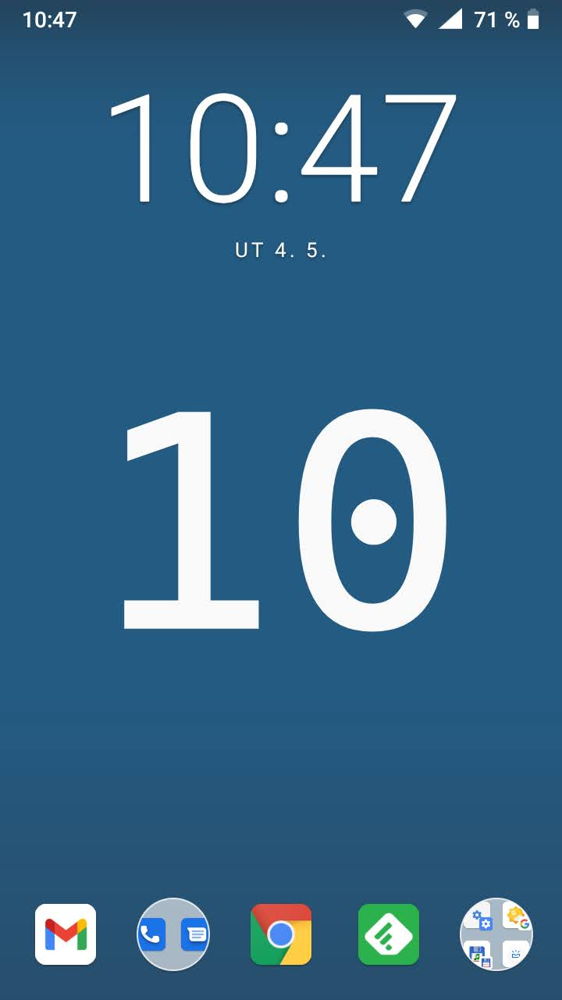

# data-livewallpaper
### Unlock Clock
- ##### Based on [googlecreativelab/digital-wellbeing-experiments-toolkit](https://github.com/googlecreativelab/digital-wellbeing-experiments-toolkit/tree/master/liveWallpaper)
- ##### Changed *background [color : `#454a4c`](https://github.com/milankomaj/data-livewallpaper/blob/b5c08d901c4341d0178ba37436c8bee609b97a44/app/src/main/res/values/colors.xml#L22)* , *images:* *`*.png`* to  [`*.webp`](https://developers.google.com/speed/webp)
- ##### Changed *[font](app/src/main/res/font/mon.ttf) [(`86,95`)](https://github.com/milankomaj/data-livewallpaper/blob/b5c08d901c4341d0178ba37436c8bee609b97a44/app/src/main/java/com/digitalwellbeingexperiments/toolkit/datalivewallpaper/UnlockCounterWallpaper.kt#L81)* : [ Cascadia Code :copyright:](https://github.com/microsoft/cascadia-code) ([SIL Open Font License 1.1 ](https://github.com/microsoft/cascadia-code/blob/main/LICENSE)), *`textSize` : [(`144,145`)](https://github.com/milankomaj/data-livewallpaper/blob/b5c08d901c4341d0178ba37436c8bee609b97a44/app/src/main/java/com/digitalwellbeingexperiments/toolkit/datalivewallpaper/UnlockCounterWallpaper.kt#L143)*
- #####  
- #####  Unit tests: Sat Nov 21 12:24:35 CET 2026

 

---

---

<strong>SHA-256</strong>

  
**sha256** | **file**
---: | :---:
38e484249d1055e073fbb3741fd82cbe8e99a95751d9a88653ac9bdc35dc4856|./artifacts/MyApp/data_live_wallpaper_motorola_edge_70_debug.apks
e886c80688753add6784f5221e44c1026e969e96faa0445a1d6f63c17b9a3065|./artifacts/MyApp/data_live_wallpaper_relase_all.apks
a8af3c1a94abe240a1d725b8703e1ca3105ccef6aa36bde524da6b6590287422|./artifacts/MyApp/data_live_wallpaper_motorola_edge_70_relase.apks
a490d8bf20434b37f1f1db5d21b1cc8f75d54539d9cf2fde464c6274bccf2452|./artifacts/MyApp/data_live_wallpaper_debug_all.apks
2ea2cce0aca81854ac149e8e2a598f0825f3ab39e88e925efb0b2bc496f50ca1|./artifacts/app/build/outputs/apk/release/data_live_wallpaper_release.apk
cc0548ea8269cfeb5112a25ab98e2221530d0c49b8d1218f9dfc653dcec8716e|./artifacts/app/build/outputs/apk/debug/data_live_wallpaper_debug.apk
12d4e454659dc00b7597993c8c65abc04abc12f9b60ecf6457087e3351e4d50d|./artifacts/app/build/outputs/bundle/release/app-release.aab
19cfa16a3d15c7d96d5b8cae29e8931e77a9c24a52dc8a639d5ee3871bb333a5|./artifacts/app/build/outputs/bundle/debug/app-debug.aab

