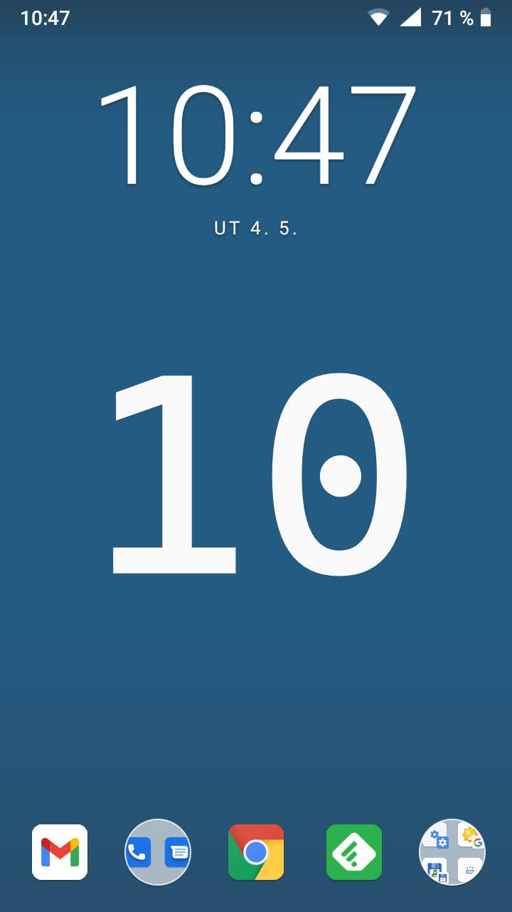

# data-livewallpaper
### Unlock Clock
- ##### Based on [googlecreativelab/digital-wellbeing-experiments-toolkit](https://github.com/googlecreativelab/digital-wellbeing-experiments-toolkit/tree/master/liveWallpaper)
- ##### Changed *background [color : `#454a4c`](https://github.com/milankomaj/data-livewallpaper/blob/b5c08d901c4341d0178ba37436c8bee609b97a44/app/src/main/res/values/colors.xml#L22)* , *images:* *`*.png`* to  [`*.webp`](https://developers.google.com/speed/webp)
- ##### Changed *[font](app/src/main/res/font/mon.ttf) [(`86,95`)](https://github.com/milankomaj/data-livewallpaper/blob/b5c08d901c4341d0178ba37436c8bee609b97a44/app/src/main/java/com/digitalwellbeingexperiments/toolkit/datalivewallpaper/UnlockCounterWallpaper.kt#L81)* : [ Cascadia Code :copyright:](https://github.com/microsoft/cascadia-code) ([SIL Open Font License 1.1 ](https://github.com/microsoft/cascadia-code/blob/main/LICENSE)), *`textSize` : [(`144,145`)](https://github.com/milankomaj/data-livewallpaper/blob/b5c08d901c4341d0178ba37436c8bee609b97a44/app/src/main/java/com/digitalwellbeingexperiments/toolkit/datalivewallpaper/UnlockCounterWallpaper.kt#L143)*
- #####  
- #####  Unit tests: Sat Nov 14 12:24:56 CET 2026

 

---

---

<strong>SHA-256</strong>

  
**sha256** | **file**
---: | :---:
38e484249d1055e073fbb3741fd82cbe8e99a95751d9a88653ac9bdc35dc4856|./artifacts/MyApp/data_live_wallpaper_motorola_edge_70_debug.apks
269c87d9dd339c0cfed12c472267f55bb6df993a5bcadb5f1ba3f72e6b7259a3|./artifacts/MyApp/data_live_wallpaper_motorola_edge_70_relase.apks
a490d8bf20434b37f1f1db5d21b1cc8f75d54539d9cf2fde464c6274bccf2452|./artifacts/MyApp/data_live_wallpaper_debug_all.apks
cd93d05e36d0313c0634ce8c9c7a1f4c0f72f410f4c876b95babf14cbd853ddb|./artifacts/MyApp/data_live_wallpaper_relase_all.apks
b82cb5c6f129cadc450e7243406f30daa34d73a73176ddaa84e57e17a4c21c3a|./artifacts/app/build/outputs/apk/debug/data_live_wallpaper_debug.apk
481d3288ee54922dc0b8601e9e7b3e64b951b932baf9efee9a834dc1c63e6975|./artifacts/app/build/outputs/apk/release/data_live_wallpaper_release.apk
6c1c71b61b028613ca815d4a7a99bf30b4eee06b0489432854ff16fd50397de5|./artifacts/app/build/outputs/bundle/debug/app-debug.aab
641787fe21148cff85b4f3cc83285d34e4c255f3cfe4d51de344f3f5a00d9ed3|./artifacts/app/build/outputs/bundle/release/app-release.aab

